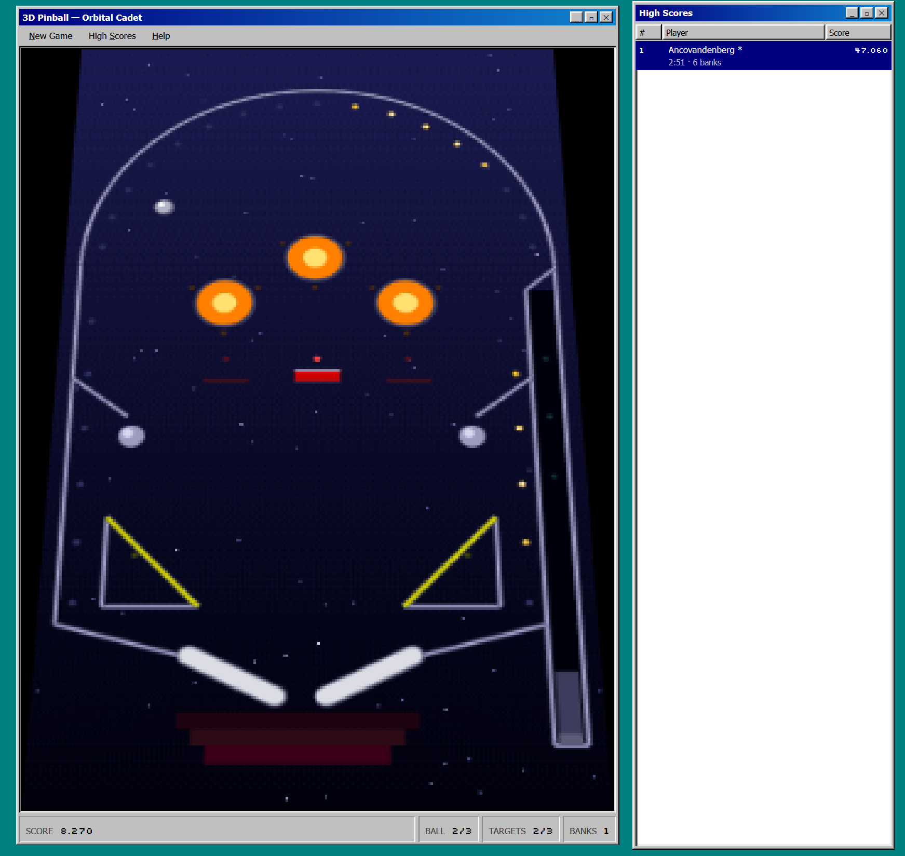

# Orbital Cadet

> A playable pinball table, physics and all, running as a Fabric App with an Entra-gated
> leaderboard behind it. An original homage to the Windows 3D Pinball era, drawn in code,
> with no assets from the original game.



The hosted app is protected, so its URL only resolves for people signed in to the workspace's
tenant. A signed-out request gets a 401 and an empty body. Deploy your own copy to try it.

## What it does

- A full simulation: plunger, two flippers, three pop bumpers, a three-target drop bank worth
  5,000 when you clear it, two slingshots, posts, and a launch lane with a one-way flap. Three
  balls a game.
- Fixed-timestep physics at 1/240 second substeps, so a ball at full speed cannot tunnel through
  a 13-unit drop target.
- Flipper collisions resolved in the moving surface's frame, which is what makes a swung flipper
  impart real force rather than just bouncing the ball back.
- A leaderboard in a Fabric SQL database, readable by everyone in the workspace, writable only
  by the person whose score it is.
- Windows 95 chrome, drawn rather than themed: teal desktop, two windows, bevels as inset
  box-shadows, a working menu bar, a recessed status bar, and zero border-radius anywhere.

Controls are keyboard first: space or enter starts a game, hold space to charge the plunger and
release to launch, arrow keys or A and D work the flippers. Touch buttons appear below the table
on narrow screens.

## How it is built

The playfield renders top-down into a 240 by 426 buffer, then gets projected into a 240 by 309
one before anything reaches the screen. That second step is why it reads as period rather than
as a modern canvas game wearing a costume: the original is not drawn top-down, and a straight
overhead render is the most un-90s thing a pinball table can do.

For a plane under perspective both `1/z` and `u/z` vary linearly in screen space, so the source
row for any screen row is `t / (0.8 + 0.2t)` and that row's width is just `1/z`. It is drawn as
two-pixel scanline bands, which is how you faked depth before anyone had a 3D pipeline, and the
chunky stepping suits the pixel buffer anyway.

The rest is palette discipline. A six-step vertical ramp dithered through a 4 by 4 Bayer matrix,
so the sky stipples the way a 256-colour gradient did. Flat concentric rings for bumpers rather
than radial gradients. 57 lamps along the rails and around the bumpers, two-state rather than
fading, because a 256-colour game had a lit frame and an unlit frame.

Layout of the source:

| Path | What it holds |
|------|---------------|
| `packages/frontend/src/game/engine.ts` | Simulation: collision resolution, flippers, plunger, scoring |
| `packages/frontend/src/game/table.ts` | Playfield geometry, walls, bumpers, targets, lamps |
| `packages/frontend/src/game/render.ts` | VGA palette, dither, lamps, the perspective projection |
| `packages/frontend/src/game/layout.ts` | Resolves the playfield to pixels on both axes |
| `packages/data/src/HighScore.ts` | The one entity, and its permission split |

The engine is free of React and of the canvas. It owns state and time, the renderer only reads,
and the host drains an event queue to drive flashes and score popups.

## Run it locally

```
npm install
npm run dev -- -w "<your workspace name>"
```

`rayfin dev` does not read `RAYFIN_WORKSPACE_NAME` from `rayfin/.env`, so pass the workspace on
the command line. It provisions or reuses a Fabric backend, applies the schema, and starts Vite
on http://localhost:5173.

Click the table once before using the keyboard. The listeners are bound to the window, so the
page needs focus, and inside the Fabric portal the app is in an iframe that does not have it
until you click.

## Deploy

```
npx rayfin up --workspace "<your workspace name>"
```

This builds the static app, deploys it, and applies any pending schema migration in one step.
`npx rayfin up status` checks the result afterwards.

Note that `rayfin up status` misreports the SQL database: it shows the oldest SQL Database in the
workspace rather than this item's own child. Use `npx rayfin connector search --json` to see the
real per-item databases.

## The permission split

Worth copying into anything with a shared list. Read is open to any signed-in user, since a
leaderboard nobody else can see is not a leaderboard. Create, update and delete each carry a
policy pinning `owner_id` to the caller's own subject claim, so a forged row is rejected by Data
API Builder before it reaches the table rather than being filtered out in the UI.

`owner_id` is stamped from the live session at create time, not passed in, because the policy
only accepts a row whose owner matches the caller.

## What I learned

Every visual decision in this build was made from source, with no browser to check against. One
layout bug passed typecheck, lint, 56 tests and a clean build while being completely broken on
screen: the canvas took its width from a percentage height, which cannot feed back into the
parent's intrinsic width, so the window sized itself to its status bar at 605 pixels while the
canvas computed 1243 from the viewport and painted across the desktop. The fix was to resolve
both axes to pixels in JavaScript. The better fix was making it a pure function with 24
assertions across seven viewports, because that bug class is invisible to every other gate.

A ball could come to rest on a flipper pivot. On the apex of a round cap the contact normal
points straight up, so gravity has no tangential component to roll the ball off, and a flipper
cannot throw it clear either because surface velocity scales with distance from the pivot and is
nil exactly there. The first fix treated it as a table problem and pulled the side walls back,
which opened a gap either side that the ball fell straight through. It was a physics problem all
along.

The first regression test for that bug was worthless. It measured how long the ball lingered near
a pivot during hands-off play, and it passed against the broken geometry, because a simulation
left to itself never wandered into that corner. The replacement places the ball exactly on the
pivot and fails at 2.9 seconds without the fix. Reverting a fix to watch its test fail is cheap
and catches tests that assert nothing.

## Known limits

- The deployed app has never been validated in a browser end to end. The gates it passes are
  static plus a 401 check on protected hosting.
- No sound.
- Below 1024 pixels wide the layout stacks and the page scrolls. A 440 by 780 table cannot
  usefully fit a phone's height.
- The stuck-escape fires after 0.8 seconds of a near-motionless ball, so if one ever finds a
  resting spot the geometry misses, you will see it hop on its own.

## On the original

Table dimensions, the camera angle, gravity constants, scoring values and the object inventory
were read from a public reverse-engineering project. None of the original artwork, and none of
its data files, which that project deliberately does not ship either. The table layout, the
palette and every sprite here are original.
